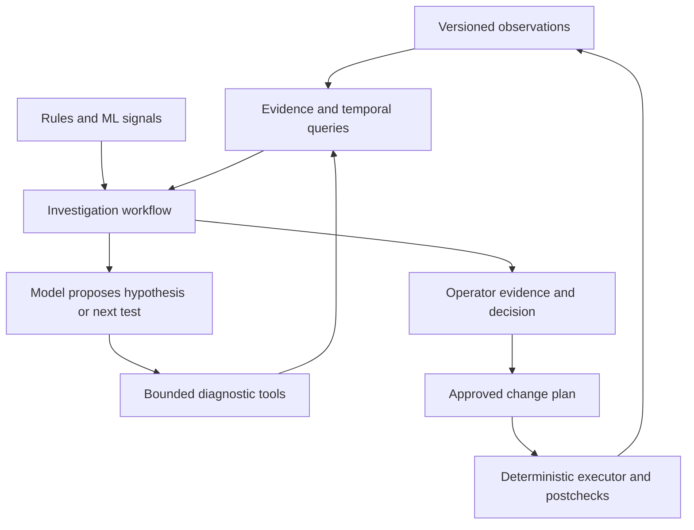

# Bonsai: evidence-driven agentic NetOps

Research and implementation strategy — 11 October 2026

## 1. Decision

Make Bonsai an investigation and change-assurance workbench built around a trustworthy network evidence model. Use modern models to choose diagnostic questions, reconcile evidence, explain alternatives, and draft tested changes. Keep telemetry decoding, identity, authorization, execution and outcome verification deterministic.

The strongest opportunity is the combination of routing visibility from RustyBMP, Bonsai's network graph, vendor-aware observations, and a replayable investigation history. A useful product should answer: **What changed, what does it affect, what evidence supports that conclusion, what should we check next, and what happened after the approved action?**

This complements `BONSAI_RUSTYBMP_CODEX_HANDOFF.md`; it does not replace its B00–B22 foundation work. Continue the merger. Pull the evaluation and investigation-runtime corrections below forward; develop the first read-only agent feature after trustworthy identity, routing state and evidence replay exist.

### Scope and evidence

Reviewed baseline:

- Bonsai: `g-arjuna/bonsai`, commit `20903963155c27b35a8c511df229d71b848f7aa0`.
- RustyBMP: commit `e2a1189392db520b25a376795e1bfae72eca5b55`, as audited in the merger handoff.
- The user's subsequent Ubuntu changes were not available for this review. Reconcile findings against that branch before implementing.
- Research cut-off: 11 October 2026. Sources include official project documentation, research papers and first-party operational reports. Preprint results are distinguished from production evidence.
- Static inspection and two small Python probes were performed. No full Rust build, GPU training, containerlab experiment or live-network validation was performed here.

All architectures, task priorities and release gates below are recommendations. They are not claims that Bonsai currently implements them.

## 2. What the 2026 evidence actually changes

The useful advance is models participating in bounded, executable workflows. Their quality must be measured against network outcomes and the correctness of the evidence they use.

| Evidence | Relevant lesson | Limitation |
|---|---|---|
| Microsoft's September 2026 account of network agents [S1] | Focused diagnostics, ticket preparation and human-approved handoffs fit existing operational work. | First-party operational report, not an independent comparison or a promise of equivalent savings. |
| NetArena, ICLR 2026 [S2] | Generate network tasks and evaluate correctness, safety and latency in an executable environment. | Published results concern particular tasks/models, not all October models. |
| NetConfArena, August 2026 preprint [S3] | Validate resulting behavior rather than configuration-text similarity; model and reasoning settings change both cost and success. | Controlled topologies; rollback and multivendor operation are outside its evaluated scope. |
| DiagGuard, August 2026 preprint [S4] | A correct root-cause label can conceal an unsupported propagation story. Evaluate grounding separately. | Its result is not proof that a network diagnosis is causal. |
| Real-world telemetry RCA study, July 2026 [S5] | Distinguish missing evidence from failures to reason over available evidence. | Additional model effort cannot manufacture observations. |

My inference: Bonsai can compete on reliable evidence assembly, network-specific diagnostic tools and reproducible scenario packs. Merely adopting a larger model will not produce those capabilities. Equally, strong models deserve a real trial: hard cross-domain incidents and unfamiliar vendor output are sensible places to spend reasoning budget.

## 3. Important findings in the existing implementation

Use the pinned [Bonsai source tree](https://github.com/g-arjuna/bonsai/tree/20903963155c27b35a8c511df229d71b848f7aa0) when checking these findings.

| File / observed behavior | Operational implication | Required improvement |
|---|---|---|
| `src/investigation_runtime.rs`: provider loop, 15-iteration limit, investigation and daily budgets already exist. | Useful starting point; preserve the working integration. | Add durable states, budget reservations and bounded evidence contracts. |
| Same file, fallback around lines 245–267 stores `completed` after unsuccessful loop exits. | An exhausted or failed run can appear successfully investigated. | Separate `completed`, `partial`, `budget_exhausted`, `failed`, `cancelled`, `awaiting_human`; record stop reason. |
| `extract_rca_json` accepts loosely extracted JSON and otherwise `{}`. | Prose and malformed output can masquerade as a result. | Validate a typed result schema; unsupported claims cannot become facts. |
| `preflight_quality(..., _device_address)` computes graph-wide quality; `queried_paths` contains tool names. | Global health and a tool-name checklist do not establish incident-specific evidence completeness. | Assess coverage by entity, interval, source and required observation. |
| Daily cost-query failure logs and proceeds. | Budget observability failure need not stop further spending. | Reserve costs transactionally; on reservation/storage failure pause model calls with a visible reason. |
| `src/mcp_server.rs`: `query_graph` uses a keyword denylist with the normal graph connection; the code notes this is not a security boundary. | Model-access policy is not enforced by filtering strings. | Scoped read-only execution, query timeout/row/byte caps; prefer purpose-built tools. |
| `python/bonsai_ml/gnn/stgnn.py`, lines 395–411: temporal embeddings assigned by row position. | Node addition/removal can mix different devices' histories even if each snapshot is sorted. | Align by stable entity IDs; add existence/missingness masks and elapsed time. |
| `gnn/conformal.py`: threshold calibrated on clean scores, but documentation/output claims anomaly coverage. | False-alarm calibration is being confused with guaranteed anomaly recall. | Define the target statistical claim; correct outputs and tests before exposing confidence. |
| `gnn/eval.py`: point-adjusted F1 fills an entire anomalous interval after one detection. | Delayed or sparse detections can look excellent. | Make event recall, detection delay and false alerts primary. Preserve raw metrics. |
| `python/bonsai_ml/feature_schema.py`: explicit feature schema metadata/hashing. | A valuable existing foundation for reproducibility. | Extend lineage through raw observations, parsers, features, training and calibration. |

### Two executed counterexamples

1. With calibration scores `[0.5] * 20 + [0.1] * 5` and labels `[0] * 20 + [1] * 5`, the existing calibrator selects threshold `0.5`, detects none of the five anomalies, and its coverage output still includes `coverage_guarantee: 0.9`. This disproves the advertised anomaly-recall interpretation; it does not disprove conformal methods.
2. For 100 normal points, 100 anomalous points, then 100 normal points, flagging only the last anomalous point gives raw F1 approximately `0.019802`; the repository's point adjustment yields `1.0`.

These are narrow executable probes, not a full ML test suite. Turn both into regression cases. The broader literature also documents problems with point adjustment [S6]. Temporal dependence requires particular care when stating conformal guarantees [S7].

## 4. Build a network evidence model before an agent memory

### Canonical observation envelope

Introduce a versioned envelope shared by BMP, gNMI, syslog, CLI snapshots, configuration changes and synthetic tests:

```yaml
schema_version: 1
observation_id: immutable-id
tenant_id: lab-or-organization
entity_refs: [stable-device-id, stable-vrf-id, stable-peer-id]
event_time: source-time-or-null
received_time: collector-time
clock_quality: synchronized-or-unknown
source: {kind: bmp, collector_id: collector-1, session_id: session-7}
source_semantics: {view: pre-policy, direction: inbound}
parser: {name: adapter-name, version: immutable-version}
raw_ref: content-addressed-object-reference
payload: {}
quality: {completeness: partial, missing_fields: [], reason: null}
```

This is a proposed contract, not an existing API. Define concrete tagged unions for each observation type; do not leave production payloads as unconstrained dictionaries.

Identity must distinguish tenant, device, network instance/VRF, address family, peer, session epoch and route view. An IP address alone is not a globally unique entity. Preserve vendor-native names as aliases. Interface renames and device replacements require explicit identity policies. Route keys need negotiated protocol semantics; do not collapse distinct paths, views or routing domains.

Preserve source and receive times, ordering/session sequence, duplicates, gaps, late arrivals and staleness. A missing route is not evidence of withdrawal when the collector lost its session. Unknown, unsupported, absent, stale and zero must remain distinct. Record raw values and canonical units; counter resets, wraparound and polling gaps must not become false traffic anomalies.

### Integration contracts

| Input | Normalize deterministically | Preserve differences / quality |
|---|---|---|
| BMP/BGP | Peer/session identity, route announcements/withdrawals, attributes and view | Negotiated capabilities, pre/post-policy visibility, missing families and gaps |
| gNMI/OpenConfig | Typed paths, entity mapping, units, timestamps and subscriptions | Native paths, supported models, sample/on-change behavior, deletes |
| CLI/NETCONF/vendor APIs | Versioned typed observations and config snapshots | NOS/version/capability, parser failure, raw output |
| Syslog/events | Event type, entities, severity, event/receive time | Native severity, original message, uncertain entity match |
| IPAM/source of truth | Intended identity, service ownership, planned topology | Intended state separately from observed state; reconciliation conflicts |
| Changes/tickets | Change ID, actor, interval, scope, approved intent | Planned, applied, verified and reverted are different states |
| Active probes | Probe endpoints, VRF, packet size, protocol, result, interval | A probe covers one tested path and condition, not universal reachability |

gNMI provides a structured transport and path model, but does not ensure all vendors export equivalent semantics [S8]. Do not make OpenConfig availability a prerequisite for every device.

### The highest-value LLM integration: an adapter workshop

Use a strong model offline to inspect a new NOS output sample, propose a canonical mapping, generate a deterministic parser, and draft fixtures. Review the patch and run it against positive, missing-field, malformed and version-variant examples. Ship the reviewed adapter with provenance and a capability declaration.

NTC's parser-development approach of raw inputs paired with expected structured outputs provides a useful pattern [S9]. Bonsai should add semantic tests: overlapping VRFs stay separate, unknown counters stay unknown, and vendor-specific fields survive without contaminating core logic.

An unknown production message may produce a quarantined model-generated extraction candidate, with explicit uncertainty. It must not silently update authoritative routing state or train the detector. Repeated unknowns become adapter-development tasks. This creates a scalable vendor onboarding loop without recurring model cost in the hot path.

## 5. Agent architecture and useful tool boundaries



Retain Rust for ingestion, state, evidence queries, authorization and execution. First implement a small durable investigation state machine around the current runtime. Keep ML inference behind a versioned service boundary so experiments cannot destabilize routing collection.

LangGraph is an optional timeboxed spike if durable branching and human pauses become expensive to maintain. Its persistence/interrupt facilities are relevant, but resume can restart a node: side effects still require idempotency and explicit execution boundaries [S10]. Do not rewrite Bonsai merely to adopt an agent framework.

Start with one investigator. A deterministic verifier checks evidence references, query scope, freshness and tested invariants. A second model may critique difficult cases under a separate budget; agreement between models is not independent network evidence. Add multiple agents only after measured improvements exceed their orchestration and token costs.

### Proposed tools

| Tool | Bounded result | Why it matters |
|---|---|---|
| `get_prefix_journey` | Prefix/VRF/time interval, selected hops/views, explicit gaps | Explain where route visibility diverges. |
| `get_changes` | Entity scope and interval, versioned diffs | Test change-related hypotheses. |
| `get_peer_timeline` | Session epochs, state transitions, route-count summaries | Separate peer loss from policy or collector loss. |
| `get_evidence_coverage` | Sources/freshness/gaps for this question | Detect unanswerable questions before confident prose. |
| `compare_snapshots` | Typed state differences with evidence references | Deterministic temporal comparison. |
| `run_readonly_check` | Allowlisted check, scope, timeout, rate budget | Obtain missing evidence without arbitrary shell access. |
| `evaluate_change_plan` | Invariant results, supported scope and limitations | Test candidate changes before approval. |

Every result carries observation IDs, as-of time, filters, truncation/cursor, source status and units. Tools enforce tenant/device scope and query budgets below the model interface. Repeated identical calls are detected; cached results are keyed by tenant, authorization scope, snapshot and freshness policy.

Use graph/temporal queries for facts. Use semantic retrieval for documentation, supported runbooks and adjudicated incidents, filtered by NOS/version and effective date. Embedding similarity must not replace an exact prefix, VRF or time query. Treat retrieved logs and documents as data, including any embedded instructions.

### Typed investigation result

Require `status`, `question`, `scope`, `as_of`, `observed_facts`, `hypotheses`, `supporting_evidence_ids`, `counterevidence_ids`, `missing_observations`, `next_check`, `impact`, and `recommended_plan_id` when applicable. Validate evidence IDs and scope mechanically.

Display model confidence only as explicitly uncalibrated judgment unless validated calibration exists for the relevant task. Prefer operational states: supported, plausible, contradicted, insufficient evidence. Keep a concise explanation of the conclusion and checks; do not expose private chain-of-thought as an audit mechanism.

Persist run transitions, inputs, tool results, model/prompt/tool/schema versions, latency, tokens/cost and stop reason. A crash/restart must resume or visibly terminate. Stale evidence triggers revalidation, not silent continuation.

## 6. First product feature: explain a missing prefix

Question: “The BGP session is up. Why can this service not reach prefix P in VRF V?”

1. Resolve device, VRF, prefix, service and time interval deterministically.
2. Check available BMP views and collector continuity. Report any missing view before interpreting route absence.
3. Compare route visibility and relevant attributes across observed peers and times.
4. Retrieve associated policy/config changes, next-hop state and relevant topology.
5. Rank hypotheses: export policy, import policy, next-hop resolution, forwarding problem, wrong VRF, stale observation, or insufficient evidence.
6. Choose the next discriminating check. Prefer a cheap precise read over another broad model call.
7. Present facts, alternative explanations, the unresolved question and impact scope.
8. If appropriate, draft a plan with exact preconditions and tests; the operator decides whether to proceed.

Do not infer installed FIB state or packet reachability solely from BMP. An authoritative answer may be: “We see the route pre-policy but lack post-policy and forwarding evidence; the next useful check is X.” Such an answer is operationally valuable.

### Subsequent scenarios

| Scenario | Useful reasoning | Independent evidence |
|---|---|---|
| Interface failure followed by BFD/BGP churn | Distinguish common-cause cascade from many unrelated incidents | Link/BFD timeline, topology, probes |
| Maintenance churn | Explain expected versus unexpected impact | Approved maintenance scope and postchecks |
| Brownout with healthy routing | Ask about MTU, loss, queueing and path-specific behavior | Sized probes, drop/queue counters, timestamps |
| Two tenants use the same prefix | Keep incidents and recommendations isolated | Tenant/VRF identity regression fixtures |
| New NOS release changes output | Diagnose ingestion quality separately from network failure | Raw sample, parser version, fixture comparison |
| Suspected route leak | Test observed policy and propagation against intent | Supported route views, explicit invariants and independent checks |

Containerlab emulation does not faithfully reproduce every ASIC, optical or microburst behavior. Mark simulated versus hardware-validated coverage in the UI and benchmark.

## 7. Elevate ML through stronger comparisons and lineage

### Detection portfolio

| Layer | Initial role | Promotion requirement |
|---|---|---|
| Invariants and state machines | Session loss, impossible transitions, ingestion gaps | Fixture and replay correctness |
| Robust statistical baselines | Rate/latency deviations, seasonality, counter discontinuities | Stable false-alert and delay performance |
| Small supervised/tabular model | Rank signals with adjudicated labels | Chronological and topology/vendor holdouts |
| Time-series foundation model | Forecast distributions and residual-based candidate signals | Beats simple baselines at equal alert budget and acceptable inference cost |
| GNN/STGNN | Explore topology-aware ranking and propagation patterns | Stable identity, masks, ablations and cross-topology validation |
| LLM | Interpret evidence, choose tests and explain alternatives | Grounded task success and operational utility |

Do not collapse anomaly, fault, root cause and customer impact into one score. A predictable event can still violate intent; an unusual event can be harmless.

Chronos-2 is a credible forecasting challenger with multivariate/covariate support [S11]. TimesFM 3.0 adds relevant capabilities, but its official repository distinguishes its downloaded-weight license from earlier releases: it is not an unrestricted self-hosted production drop-in [S12]. Evaluate deployable versions and their exact licenses; start with one foundation-model challenger, not a platform supporting every model.

For each experiment, record data window, sampling/aggregation, units, missingness treatment, entity mapping, feature-schema hash, parser versions, label provenance, code commit, model weights/version, calibration and threshold selection. No random train/test split across adjacent windows from the same incident. Hold out time, topology and a vendor/version where feasible. Fit transformations and thresholds using training/validation data only.

Repair STGNN identity alignment before evaluating it. Compare against the same model without topology and without temporal components. Attention highlights are useful inspection aids, not causal explanations. Add topology-change tests and evaluate cold-start entities separately.

Correct the conformal target first. A clean-data threshold may support a carefully qualified false-alarm claim under stated assumptions; it does not guarantee recall of unseen anomalies. Dependent and drifting telemetry requires appropriate methods and empirical monitoring [S7]. Recalibration must be versioned, with an explicit rollback path.

Do not fine-tune an LLM initially. Collect adjudicated evidence bundles and compare retrieval/tool improvements first. Later fine-tuning should target stable repeated behavior, such as structured extraction, with held-out versions and independent validators. Successful-looking agent traces are not automatically suitable training examples.

## 8. Human-in-loop that reduces work

An incident view should show: impact, facts with clickable evidence, hypotheses and counterevidence, missing observations, next check, and the cost/scope of that check. The operator should be able to correct an entity, reject a hypothesis with a reason, request one check, or accept a tested plan.

For a proposed change, show exact device/VRF scope, configuration diff, intended behavior, independent test results, prerequisites, expected disruption, postchecks and recovery procedure. Approval binds to a plan hash, configuration versions, scope and expiry. A changed plan or stale baseline requires renewed approval. Do not use an ambiguous “approve agent” button.

The executor receives only the approved typed plan. It checks authorization and preconditions again, uses idempotency keys and journals each step. Enforce one owner/lock for conflicting changes. Test disconnects and partial application. If postchecks fail, halt and follow the approved recovery policy; blindly applying a reverse diff is not universally safe.

Batfish differential questions can compare modeled snapshots [S13]; containerlab and device checks add executable observations. Neither proves all real hardware behavior. Report unsupported constructs and incomplete coverage explicitly.

Feedback is structured: correct/incorrect/unknown diagnosis, useful/useless next check, evidence missing, action outcome and operator rationale. Record who adjudicated and with what evidence. Acceptance of a recommendation is not proof that the root cause was correct. Never silently train on unresolved feedback.

## 9. Evaluation is a product capability

Create a versioned scenario pack alongside code. Each scenario contains topology and image references, setup, fault or no-fault intervention, expected observable evidence, hidden oracle, allowed tools, time budget and cleanup procedure. Keep oracle data outside the agent's accessible inputs.

Starter proposal: eight families, five held-out variants each, with additional no-fault and insufficient-evidence cases. This is an engineering starting set, not statistical proof of generalization. Families: policy filtering; next-hop resolution; peer reset; link/BFD cascade; collector gap; overlapping VRFs; counter reset/telemetry staleness; approved maintenance. Begin with FRR; add a legally available second NOS per B18.

Run fixed seeded replays for deterministic comparisons and live lab runs for timing/control behavior. Snapshot topology, configuration and observation schemas. Randomize addresses/names and split by templates, not merely by seed, when testing generalization. Add malformed tool output, instruction-like log content, budget exhaustion and contradictory evidence.

| Dimension | Measure |
|---|---|
| Diagnosis | Correct supported hypothesis; abstention when evidence is insufficient |
| Explanation | Evidence validity, unsupported causal claims, counterevidence handling |
| Detection | Event precision/recall, false alerts per device-day, detection delay, PR-AUC where appropriate |
| Action | Invariant preservation, allowed scope, postcheck success and recovery outcome |
| Agent execution | Tool errors, repeated calls, stale-result use, restart behavior |
| Economics | Cost per correctly resolved case, p50/p95 latency, operator minutes and escalation rate |

Compare identical evidence/tool access for a deterministic runbook, a smaller model, a stronger model and the proposed routing policy. Report failures by scenario, not just a mean score. Do not let an LLM judge its own success; executable oracles and blinded human review are primary. Model graders can triage explanation quality with measured disagreement.

Release gates should be agreed against the lab baseline. Non-negotiable engineering gates: no cross-tenant evidence in the test set, all factual citations resolve, stale approval cannot execute, no write path from read-only investigations, crash recovery and partial failures are observable. Statistical performance thresholds need baseline data and uncertainty; do not invent a universal 95% accuracy promise.

## 10. LLMOps, model routing and cost

Separate development-assistant usage from Bonsai's production model API. Available IDE model names and subscriptions do not establish API availability, data terms or runtime cost. Keep the runtime provider adapter and model selection configurable.

Use deterministic code for ingestion, aggregation, validation and routine known playbooks. Use a smaller model for bounded extraction or presentation only after schema/evaluation checks. Route ambiguous multistep diagnosis, novel adapters and difficult change planning to a stronger model. Select exact runtime models through the scenario benchmark; do not infer suitability from general coding scores.

Budget total work: model calls, tokens, tool queries, bytes/rows, elapsed time and active probes. Reserve spend before calls; reconcile actual usage. Deduplicate incidents into scoped episodes. Retrieve summaries and selected evidence, not raw route tables. Persist compact structured state rather than endlessly appending complete transcripts. Cache only within correct identity and freshness boundaries.

Track model/prompt/tool/schema versions together. Prompt changes require replay comparison, shadow evaluation and rollback just like model changes. MLflow's prompt registry and trace evaluation are optional practical integrations [S14]. Initially the existing store plus a small evaluation runner may suffice. Avoid deploying an entire MLOps stack before the first repeatable incident case.

Use OpenTelemetry-compatible tracing for agent/model/tool operations, pinning the convention version because GenAI conventions are evolving [S15]. Redact sensitive payloads; keep access-controlled evidence references. Report cost per useful outcome, not merely tokens per request.

For Codex development, continue the previous handoff's bounded-task workflow: one acceptance-tested change per task, targeted source files, short status/decision records and tests as evidence. Use the normal coding model for implementation; escalate architectural/protocol ambiguity or stubborn failures. A stronger model used once to solve a difficult boundary can be cheaper than repeated weak attempts. Avoid re-uploading the entire repository and repeating broad research for every PR.

## 11. Implementation backlog aligned with B00–B22

Each task should produce one reviewable PR or a clearly separated experiment. Sizes are relative: S = focused change; M = multiple modules; L = several independently reviewable slices. They are not delivery-time commitments.

| ID | Task / size | Dependency | Acceptance evidence |
|---|---|---|---|
| A00 | Reconcile branch and inventory current AI/ML behavior / S | B00 | Updated findings with exact current files/commits; completed work not duplicated |
| A01 | Correct conformal claims and evaluation metrics / S | A00 | Both counterexamples are regression cases; labels/assumptions match metrics |
| A02 | Fix STGNN temporal entity alignment / M | A00, stable IDs | Add/remove/reorder entity tests; masks and elapsed-time policy documented |
| A03 | Typed investigation results and honest terminal states / M | A00 | Invalid output/provider failure/budget exit never become successful RCA |
| A04 | Bounded scoped diagnostic tools / M | B12, A03 | Read-only permissions, caps, timeouts and cross-tenant tests |
| A05 | Versioned observation envelope and lineage / L | B04–B07 | Raw-to-normalized replay; gap/unknown/unit/time semantics tested |
| A06 | Incident-specific evidence coverage / M | A04–A05 | A healthy unrelated device cannot mask missing evidence in the incident |
| A07 | Prefix journey and temporal comparison / L | B06, B09, B13, A05 | Known policy/view/session cases yield correct evidence and gaps |
| A08 | Durable workflow and budget reservations / M | A03–A04 | Restart/concurrency/cancellation/storage-failure tests |
| A09 | First read-only prefix investigator / M | A06–A08 | Supported answers or useful abstention on held-out cases |
| A10 | Operator evidence/feedback view / M | B14, A09 | Facts separated from hypotheses; citations and structured correction work |
| A11 | Scenario runner and hidden oracles / L | B17; extend B18 | Reproducible manifests, seeded replays, negative cases and baseline report |
| A12 | Model/prompt comparison and trace lineage / M | A08, A11 | Cost/quality comparison under equal evidence and budgets |
| A13 | Adapter workshop pilot / M | B07, A05 | One second-NOS adapter with fixture/semantic tests; runtime deterministic |
| A14 | Forecasting challenger experiment / M | A01, A05, A11 | Baseline comparison; chronological split; license/resource record |
| A15 | GNN ablation experiment / M | A02, A11 | Improvement beyond simpler models or documented decision to defer |
| A16 | Intent/invariant and plan schema / M | A07, A11 | Typed plans, exact scope, supported validation and stale-plan rejection |
| A17 | Lab-only change assurance prototype / L | A10, A16, B18–B19 | Independent pre/postchecks and partial-failure/recovery tests |
| A18 | Approval-bound executor / L | A17 | Plan hash, policy, locking, idempotency and restart verified in lab |
| A19 | Shadow operational pilot / M | A09–A12 | Operator utility and failure taxonomy; no implied write authorization |
| A20 | Release readiness and contribution packs / M | Pilot evidence | Capability matrix, reproducible scenarios, model/data cards and rollback procedures |

### Suggested cadence

**Next development slice:** A00, A01 and A03 while continuing merger foundations. These make current results truthful and do not require a new platform. A02 is urgent before any STGNN result is used, but need not block the read-only feature.

**First vertical milestone:** A04–A11 scoped to one prefix/VRF question, FRR and read-only operation. Demonstrate an answer, a correctly rejected hypothesis and an insufficient-evidence case.

**Second milestone:** A12–A15: compare models, onboard another NOS and test whether newer ML actually improves utility. Keep losing experiments documented and disabled.

**Third milestone:** A16–A18 in the lab, then separately decide operational write scope. A19 read-only shadowing can start earlier when access and foundations permit.

Maintain a weekly short demo with one fresh held-out case, replay report, failure explanation and next bounded task. Publish capability claims only when backed by a scenario pack. The durable contribution is a growing set of verified network behaviors, not a growing set of prompts.

## 12. Codex continuation prompt

```text
Read BONSAI_RUSTYBMP_CODEX_HANDOFF.md and this companion strategy.
Inspect repository instructions and the current branch without overwriting work.
Start A00: reconcile audited findings with current code and list the smallest
necessary changes. Preserve B00–B22 dependencies and the Bonsai-first merger.

Then implement A01 and A03 as separate reviewable changes, unless already fixed.
Reproduce the documented calibration/point-adjustment cases and runtime terminal
state behavior before editing. Use meaningful targeted regression tests.
Do not add a new agent framework or train a model for these tasks.

Record changed behavior, commands/results, limitations and the next task in
the project status document. Do not claim full network validation from unit tests.
For later lab tasks, inspect installed Ubuntu/containerlab versions and existing
labs first; use an isolated named lab and preserve unrelated containers/configs.
```

## 13. Research ledger

Primary sources consulted; accessed 11 October 2026. These support specific patterns and limitations, not a claim that the proposed architecture has been validated.

- **S1 — Microsoft, 10 September 2026:** [From alerts to action: network operations agents](https://www.microsoft.com/insidetrack/blog/from-alerts-to-action-how-ai-agents-are-reshaping-network-operations-at-microsoft/). First-party operational experience.
- **S2 — NetArena, ICLR 2026:** [Microsoft Research publication](https://www.microsoft.com/en-us/research/publication/netpress-dynamically-generated-llm-benchmarks-for-network-applications/?lang=ja); [benchmark repository](https://github.com/Froot-NetSys/NetArena). Executable network evaluation.
- **S3 — NetConfArena, 24 August 2026:** [Paper](https://arxiv.org/html/2608.23179v1). Preprint; inspected methodology, results, failure taxonomy and limitations.
- **S4 — Beyond Fault Localization / DiagGuard, 21 August 2026:** [Paper](https://arxiv.org/abs/2608.21310). Preprint on grounded diagnostic reasoning.
- **S5 — How Far Can Root Cause Analysis Go on Real-World Telemetry Data?, July 2026:** [Paper](https://arxiv.org/abs/2607.13548). Evidence availability versus reasoning limitations.
- **S6 — Towards a Rigorous Evaluation of Time-series Anomaly Detection:** [Paper](https://arxiv.org/abs/2109.05257). Earlier foundational critique relevant to current evaluation.
- **S7 — Conformal prediction for time series, January 2026:** [Paper](https://arxiv.org/abs/2601.18509). Temporal dependence and methodological assumptions.
- **S8 — OpenConfig:** [gNMI specification](https://github.com/openconfig/reference/blob/master/rpc/gnmi/gnmi-specification.md). Protocol and observation semantics.
- **S9 — Network to Code:** [Parser development guidance](https://github.com/networktocode/ntc-templates/blob/master/docs/dev/dev_parser.md). Structured parser fixtures.
- **S10 — LangGraph:** [Persistence](https://docs.langchain.com/oss/python/langgraph/persistence), [interrupts](https://docs.langchain.com/oss/python/langgraph/interrupts). Durable workflow facilities and resume behavior.
- **S11 — Amazon Science:** [Chronos forecasting repository](https://github.com/amazon-science/chronos-forecasting). Current model capabilities and deployment details.
- **S12 — Google Research:** [TimesFM README](https://github.com/google-research/timesfm/blob/master/README.md). Current versions, capabilities and differing weight-license terms.
- **S13 — Batfish:** [Differential questions](https://batfish.readthedocs.io/en/stable/notebooks/differentialQuestions.html). Modeled snapshot comparisons.
- **S14 — MLflow:** [Prompt registry](https://mlflow.org/docs/latest/genai/prompt-registry/), [evaluation from traces](https://www.mlflow.org/docs/latest/genai/eval-monitor/running-evaluation/traces/). Versioning and evaluation infrastructure.
- **S15 — OpenTelemetry:** [GenAI observability in 2026](https://opentelemetry.io/blog/2026/genai-observability/), [attribute registry](https://opentelemetry.io/docs/specs/semconv/registry/attributes/gen-ai/). Evolving instrumentation conventions; pin adopted versions.

## 14. Decisions to record during implementation

Choose these with actual branch and lab evidence; they need not block A00–A03:

1. First service/VRF and fault family for the prefix-investigation demo.
2. Available NOS images and supported route views, including legal access to a second vendor.
3. Operational data allowed to reach hosted inference and retention/redaction requirements.
4. CPU/GPU memory, inference latency and monthly experiment budget on the Ubuntu host.
5. Minimum observation retention required for replay and incident explanation.
6. Existing source of truth and ticket workflow, before building new integrations.
7. Who adjudicates diagnostic correctness and what evidence establishes resolution.

The intended outcome is a Bonsai that produces understandable, testable operational decisions and gets measurably better with each scenario, parser and adjudicated incident.
