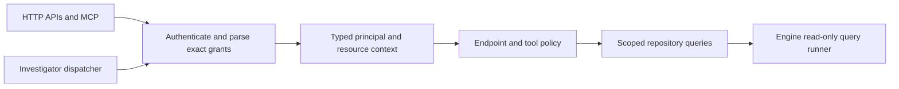

# BN-005 analysis and finite closure plan

15 October 2026, Asia/Kolkata. Reviewed uncommitted working-tree code based on
`e4d8c44`. [Active backlog](../../BONSAI_BACKLOG.md), [current status](../STATUS.md),
[results/source hashes](evidence/2026-10-15-bn005-closeout/results.json).

**Keep BN-005 Partial.** The new centralized MCP gate is the correct direction
and closes the two previously reproduced speaker-specific MCP paths in its
focused tests. The remaining problem is incomplete policy coverage, not another
missing check in those same cases. Complete the six bounded subactions below;
these are closure steps under BN-005, not another product backlog.

## What is now verified

The 11 BN-005 integration tests pass, including the original four denial cases,
resource-scoped raw-Cypher rejection, speaker-specific defaults/filtering and
plan-role checks. The 20 executor, 6 mock-provider wiring and 3 routing-workflow
tests also pass: **40 ordinary Rust tests** in this review. Python **16 tests**,
formatting, strict selected-core Clippy and UI build pass. UI warnings remain.
The hosted/local model benchmark is still pending; six mock-provider tests do
not establish real model quality/cost. Browser, imported-crate, history-recovery,
process-launch and long-running cancellation/scale gates were not rerun here.

Three independent review checks also pass: one groups three observed MCP scope
behaviors, one observes an HTTP scope bypass, and one positively confirms native
read-only transaction feasibility. A passing observed-gap probe confirms unsafe
current behavior, not security acceptance. All checks use temporary local stores
and loopback test servers. No operational device writes or provider calls occur.

## Remaining findings and their limits

| Priority | Finding | Evidence and implication |
|---|---|---|
| P1 | Malformed routing scopes become unscoped viewer access | Provisioning a key with `routing:read:speaker=192.0.2.1,unknown=value` makes parsing return None, but prefix-based role mapping grants Viewer. The MCP path does not reject the failed parse, and raw graph queries succeed. This is fail-open handling of malformed stored configuration, not an attacker changing a valid key's scope string. |
| P1 | Tenant-only and VRF-only keys get global inventory | Keys `routing:read:tenant_id=acme` and `routing:read:vrf_rd=65000:100` successfully call `query_devices` and receive the whole fixture inventory. Only a speaker constraint installs the filter. The fixture has no tenant ownership metadata, so this proves absence of an enforcing predicate; it does not assert an independently identified foreign tenant assignment. Unsupported scope combinations need denial, not an implicit global result. |
| P1 | Role promotion opens unscoped HTTP data routes | A valid key scoped to speaker `.1`, tenant `acme`, RD `0:0` receives a detection for `.2` through `GET /api/detections`. Mapping routing-read prefixes to Viewer meets generic GET role checks, while that handler never consumes the resource scope. MCP-only repair is insufficient. |
| Acceptance gap | Engine-level read-only is still unused in application diagnostic queries | The lexical validator is improved but application queries still use ordinary writable connections. The installed engine supports a read-only transaction, independently verified below. |
| Acceptance gap | All dispatch paths do not share authorization context | `run_investigation_with_provider` calls `call_tool_with_store_and_routing` directly. The gate is attached to HTTP MCP dispatch. Specify whether the investigator inherits the caller's scope or has an explicitly privileged service context; do not silently treat missing context as global authority. No provider-driven leak was executed in this review. |

The malformed-scope case, both unsupported-scope cases and the HTTP detection
read were reproduced in isolated endpoint tests. The previous speaker-specific
`get_changes` and `query_graph` fixes should remain marked repaired; these are
other input shapes and entry points within the same original acceptance.

One exploratory graph-snapshot probe returned HTTP 500, so it did not establish
read exposure. Its log is retained but is not counted as a product-gate failure
or a proven snapshot leak. The separate `/api/detections` probe returned 200 and
the foreign detection record, providing the confirmed HTTP finding.

## Target authorization flow

Transport authentication, role capabilities and data scope are separate checks.
Passing one must not bypass the others. Global access must be an explicit grant.
Do not encode trusted server context in client-supplied `_scoped_*` JSON fields.

## Six closure subactions

### 1. Fail-closed principal parsing and endpoint capabilities

Replace ambiguous `Option<RoutingAccessScope>` parsing with a typed result that
distinguishes **explicit global grant**, **valid restricted grant** and **invalid
grant**. Parse before assigning a role. Reject unknown keys, empty restrictions,
duplicates/conflicts and malformed values on every protected endpoint, including
MCP. Use exact known grant names; do not derive broad permissions solely from
`starts_with("routing:read")`. Define legacy grants explicitly.

Keep a routing-read key least-privileged. Either retain ApiReadonly and grant
specific scoped endpoints, or enforce endpoint capabilities independently of the
Viewer role. A resource-scoped key must not inherit every global Viewer GET.

Acceptance: malformed keys denied on MCP and HTTP; valid own-device calls still
work; global viewer/admin grants still work intentionally; unrelated capabilities
are denied. Include `/api/detections`, graph/topology, incidents, changes and
investigation reads in the route matrix, rather than only `/api/routing/*`.

### 2. Complete the scope-support matrix and default deny

Make one registry describe every endpoint/tool's minimum role, capabilities,
canonical fields, defaults, supported scope dimensions, ownership predicate,
response projection and limits. Test that every schema-advertised tool is registered and every protected data
route has a scoped adapter or falls under explicit default denial. A small
allowlist of scope-aware route families can deny restricted keys elsewhere
without redesigning every global-viewer endpoint. Unknown/unclassified tools deny
restricted identities by default, so future tools cannot silently bypass scope.

Fast safe behavior for the current model: deny tenant-only/VRF-only access to
inventory/change/detection tools when ownership cannot be established. If those
combinations must work, persist ownership bindings and filter queries using them
before returning data. Checking the requested tenant label is not ownership.
For combined constraints, require their intersection, not speaker-only filtering.
Document whether blast-radius results may reveal related devices; otherwise
filter/project or deny results that cross the granted boundary.

Acceptance matrix: global, speaker-only, tenant-only, VRF-only and every supported
combination; own/foreign/nonexistent resource; omitted/null/empty/conflicting
aliases; ordinary and nested plan fields; caller-supplied `_scoped_*` fields;
Viewer/ApiReadonly/Operator/Admin roles. Unsupported combinations return explicit
denial, never empty success pretending that authorization was applied.

### 3. One authorized execution boundary for every caller

Represent principal/role/grants as trusted server-side typed context. Route HTTP,
MCP and investigator tool execution through one authorized dispatcher. Push scope
predicates into repository queries rather than adding unused labels or filtering
a global result after truncation. Keep raw tool helpers private or clearly require
an explicit trusted-internal capability. Missing role/context must not implicitly
mean global permission outside a named development/trusted-service mode.

Acceptance: the same own/foreign requests have the same result through HTTP MCP,
ordinary APIs and inherited-scope investigator execution. An intentionally global
service account must be explicit, audited and not confused with the end user's
key. Mock provider tests can verify this context propagation without paid calls.

### 4. Enforce database read-only and real cancellation

A new feasibility check successfully executes `BEGIN TRANSACTION READ ONLY`,
attempts CREATE directly (bypassing the lexical validator), gets an engine error,
then confirms zero created nodes. The installed `lbug` 0.15.3 native source also
uses this transaction form. Waiting for `Connection::new_read_only` is unnecessary
for implementing a tested transaction wrapper.

Build a diagnostic runner that sets the engine timeout, begins a read-only
transaction and always ends/rolls it back on success, error or cancellation.
Retain lexical validation as defence in depth. Reject transaction-control and
multi-statement user input so a query cannot end the wrapper's transaction and
resume writable work. A database opened read-only is an alternative where file
locking/deployment architecture supports it; do not assume a second read-only
handle can be added to the live store without testing coexistence.

Acceptance: direct engine mutation attempts leave state unchanged; quoted literals
and valid reads work; transaction-control/multi-statement escapes deny; expensive
queries time out and actually stop; cancellation leaves no active transaction or
blocking worker. Test serialized output byte bounds with Unicode/escaping as
well as row limits. The transaction feasibility probe does not implement or prove
all these lifecycle protections by itself.

### 5. Subprocess deployment and persistent restart acceptance

Run actual binaries with a finite configuration matrix: token present/missing/
blank/invalid; journal paths missing/unwritable/conflicting; parsed loopback and
non-loopback addresses; explicit development overrides; Compose/service mounts.
Assert failure before serving traffic when required configuration is invalid.
Restart with the same storage and verify state/history and new observations.
Exercise correct/incorrect tokens against all internal routes.

Acceptance: default launches fail closed, explicit development behavior is
labelled, authenticated production startup works, and persisted state survives
actual restart. Unit calls to `validate_deployment` and an in-process state reload
remain useful but cannot substitute for this gate. Coordinate the actual routing
process restart with BN-003 rather than maintaining duplicate lab scenarios.

### 6. Bounded late-history and final evidence gate

Replace `all_events()` cloning in request paths with scoped pagination/indexes or
bounded scans that report cursor, scanned coverage and truncation. No diagnostic
may call early data complete while relevant later events remain unexamined.
Apply a work/time budget with explicit partial coverage when full scanning cannot
finish. Keep query filters before result caps so unrelated rows do not hide own
records in a globally capped read.

Acceptance: a dataset beyond the old 5,000/10,000 thresholds (for example 12,500
records), sparse target events near the end, interleaved sources/VRFs, paging and
restart. Verify newest relevant history, no cross-scope records, stable cursors,
explicit incomplete coverage and bounded per-request result/work allocation.
Then run the scoped endpoint/tool matrix, engine/timeout tests, launch/restart
gate and existing browser/regression/build checks at one recorded source revision.
Retain every failed run; evidence must identify the uncommitted diff or a clean
commit, environment, commands, exit codes and actual tested support matrix.

## Definition of complete BN-005

All six subactions satisfy their acceptance; every supported role/scope/tool/API
combination enforces its declared policy, unsupported combinations fail closed,
reads cannot mutate storage, expensive queries terminate, default deployment is
secure, persisted state survives process restart, and late evidence is bounded
and truthful. Documentation and evidence agree at the reviewed revision.
Only then mark BN-005 Verified. Do not close it by quietly dropping original
requirements into another backlog item.

BN-006 lab preparation can proceed independently. BN-001 executor crash phases,
BN-002 approval-key/assurance operations, BN-003 true VRF browser journey and
BN-004 real model evaluation remain separate product gates; they are not all
prerequisites to testing BN-005 and are not implicitly closed by it.

No implementation changes, commits, pushes, real-provider calls or new lab runs
were made by this analysis. Probe sources/results and the read-only feasibility
confirmation are retained for the next implementation task.
